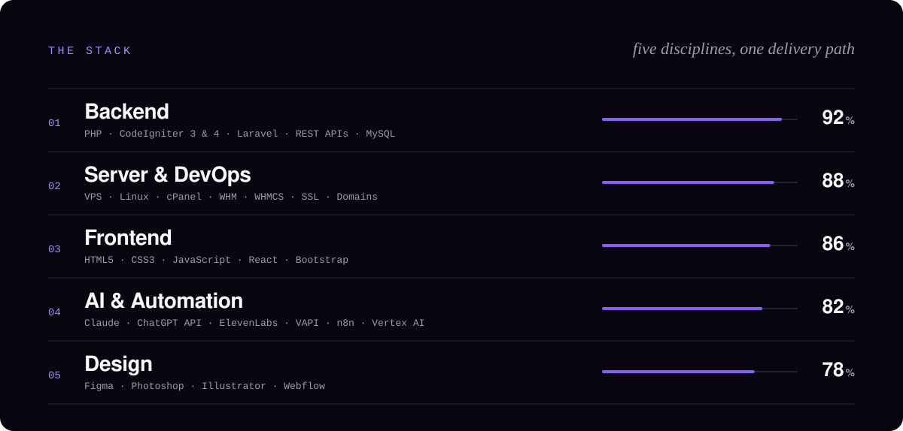
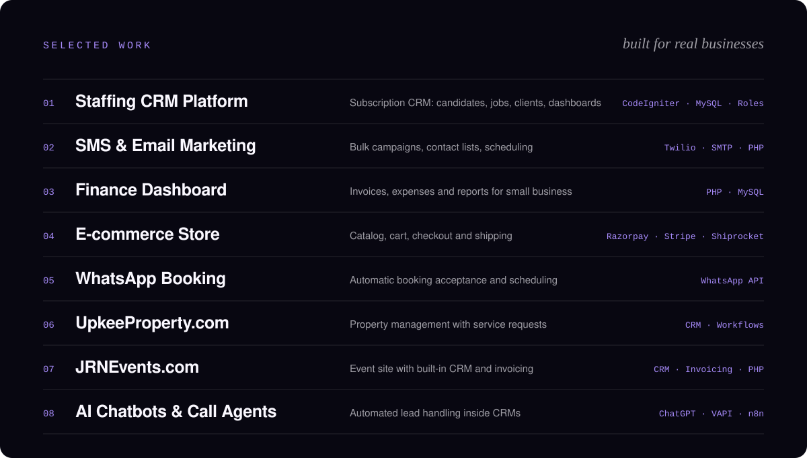
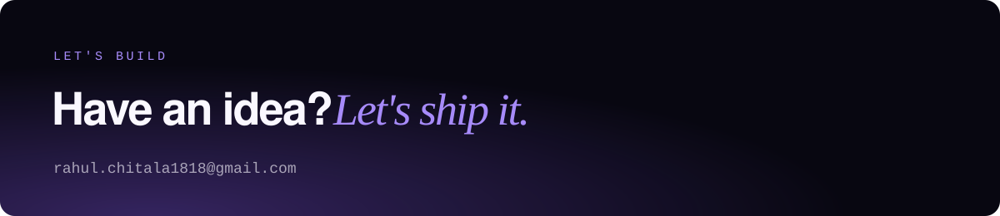

  
  

## About

I'm a full-stack developer from Hyderabad with 3+ years of experience building client websites, CRMs, SaaS products, dashboards and automation tools. I handle the whole path: UI design, frontend, backend, database, API integrations, deployment, and the Linux servers underneath.

- **Now:** PHP Full-Stack Developer at Blue Origin IT Staffing, building a Staffing CRM SaaS, an SMS and email marketing platform, and a finance SaaS
- **Before:** PHP Full-Stack Developer at The Brand Chimp, Hyderabad (custom CRMs, WhatsApp booking, AI chatbots and call agents)
- **Ask me about:** CodeIgniter, Laravel, CRM architecture, WhatsApp and Twilio integrations, AI call agents, VPS and cPanel/WHM

